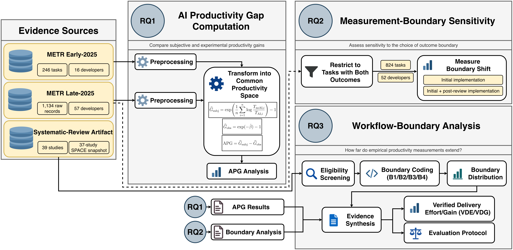

# The AI Productivity Gap

[](https://doi.org/10.5281/zenodo.23452548)

**Aligning Developer Productivity Evidence with Software Delivery Effort**

[](#reproduction-and-validation) [](#requirements) [](#repository-organization)

> **How much should software delivery estimates change when an AI coding assistant is reported to improve developer productivity?** A productivity percentage does not automatically translate into the same percentage reduction in engineering effort. Its meaning depends on who reported it, which tasks were analyzed, and which stages of the workflow were measured.

This repository accompanies the research paper **“The AI Productivity Gap: Aligning Developer Productivity Evidence with Software Delivery Effort.”** It contains scripts and artifacts for a secondary empirical analysis of two METR developer-productivity datasets and an existing systematic-review artifact. The study connects productivity evidence to software planning while distinguishing measured effects from proposed planning guidance.


## Study at a glance



*Figure 1 from the accompanying manuscript. METR Early-2025 and Late-2025 support the empirical productivity analyses; the systematic-review artifact supports workflow-boundary coding. Findings from the three RQs motivate delivery-oriented guidance, not a validated industrial effort-prediction model.*

| Research question | Question addressed | Main evidence |
| --- | --- | --- |
| **RQ1 — AI Productivity Gap** | How large is the gap between expected, perceived, and experimentally estimated productivity gains? | METR Early-2025 and Late-2025; joint developer-cluster bootstrap |
| **RQ2 — Measurement-boundary sensitivity** | How do measured effects change with the effort boundary and analysis population? | METR Late-2025; matched-task initial versus initial-plus-post-review analysis |
| **RQ3 — Workflow-boundary coverage** | How far do existing productivity measurements extend through software delivery? | Current 39-study systematic-review workbook; evidence-based B1–B4 coding |

## Main findings

### RQ1 — Subjective and experimental effects differ

We define **AI Productivity Gap (APG)** as the difference, in percentage points, between an aggregate subjective productivity gain and an experimentally estimated gain, both expressed on a common inverse-effort productivity scale. APG is a *descriptive difference between aggregate estimands*, not a task-level causal prediction error.

| Dataset / cohort | Assessment | Subjective gain | Experimental gain | APG | 95% CI for APG |
| --- | --- | ---: | ---: | ---: | ---: |
| Early-2025 | Pre-task expected | +33.05% | −15.85% | **+48.90 pp** | [33.45, 65.29] pp |
| Late-2025, all | Pre-task expected | +34.51% | +6.19% | **+28.32 pp** | [5.98, 49.32] pp |
| Late-2025, all | Post-task perceived | +29.36% | +6.19% | **+23.18 pp** | [2.85, 41.73] pp |
| Late-2025, panel | Pre-task expected | +25.14% | +22.11% | +3.03 pp | [−42.41, 44.07] pp |
| Late-2025, panel | Post-task perceived | +19.30% | +22.11% | −2.81 pp | [−48.01, 31.66] pp |
| Late-2025, new | Pre-task expected | +36.45% | +3.69% | **+32.76 pp** | [7.97, 55.40] pp |
| Late-2025, new | Post-task perceived | +31.44% | +3.69% | **+27.74 pp** | [5.24, 47.27] pp |

Intervals come from **20,000 joint developer-cluster bootstrap replicates** per comparison. The Late-2025 panel consists of only nine developers and has wide intervals; cohort comparisons are descriptive rather than randomized contrasts.

**Reproduced outputs:** [`results/tables/apg_joint_cluster_bootstrap.csv`](results/tables/apg_joint_cluster_bootstrap.csv), [`results/tables/apg_joint_cluster_bootstrap_draws.csv`](results/tables/apg_joint_cluster_bootstrap_draws.csv). The accompanying visual is generated by `scripts/14_plot_productivity_gap.py`.

### RQ2 — Boundary changes are modest on matched tasks

For the same Late-2025 tasks with both outcomes available, we compare estimated productivity based on **initial implementation** with **initial plus post-review implementation**. Matched-task comparisons separate the outcome-boundary change from changes in which tasks are eligible.

| Cohort | Matched tasks | Developers | Initial productivity | Initial + post-review | Shift | 95% CI for shift |
| --- | ---: | ---: | ---: | ---: | ---: | ---: |
| All | 824 | 52 | +9.62% | +6.39% | −3.23 pp | [−11.56, 1.65] pp |
| Panel | 137 | 9 | +25.39% | +22.11% | −3.28 pp | [−16.42, 7.34] pp |
| New | 687 | 43 | +7.29% | +3.93% | −3.36 pp | [−13.76, 1.94] pp |

All three confidence intervals include zero. These estimates describe sensitivity to this **specific recorded extension** of implementation time—not the causal effect of code review or the productivity impact over an entire delivery workflow. Comparisons using separately eligible samples can show larger shifts because task composition also changes.

**Reproduced outputs:** [`results/tables/metr_late_common_sample_boundary.csv`](results/tables/metr_late_common_sample_boundary.csv), [`results/tables/metr_late_common_sample_boundary_bootstrap.csv`](results/tables/metr_late_common_sample_boundary_bootstrap.csv).

### RQ3 — Most coded studies stop before downstream delivery

The current systematic-review workbook contains **39 studies**. Of these, **19** have a boundary-codeable empirical productivity or effort outcome, **18** are not eligible for boundary coding, and **2** remain unresolved. We assign the farthest workflow stage *directly represented in the measured outcome*:

| Boundary | Measured workflow extent | Studies | Share of 19 codeable studies |
| --- | --- | ---: | ---: |
| **B1** | Local coding or AI interaction | 3 | 15.8% |
| **B2** | Completed implementation | 11 | 57.9% |
| **B3** | Verification or rework | 3 | 15.8% |
| **B4** | Integration or delivery | 2 | 10.5% |

Thus **14/19 (73.7%)** stop at B1–B2; **5/19 (26.3%, 95% Wilson CI [11.8%, 48.8%])** reach B3–B4. An offline test oracle alone does not elevate a study to B3 unless the corresponding work is included in the measured outcome.

**Important version distinction:** The historical SPACE summary covers **37 studies**, while the current workbook used for B1–B4 coding covers **39 studies**. These are different snapshots, with **33 studies in common**; they must not be treated as the same denominator.

The first author performed the initial coding; a second author reviewed eligibility, assignments, and supporting evidence. The full set was **not independently double-coded**, and no inter-rater reliability statistic is claimed.

**Evidence:** [`data/derived/slr_boundary_current39_final.csv`](data/derived/slr_boundary_current39_final.csv) and [`docs/slr_boundary_coding_protocol_v0.1.md`](docs/slr_boundary_coding_protocol_v0.1.md). Final decisions are in `verified_eligibility` and `verified_boundary`; legacy `eligibility` and `boundary_code` columns are not the final classification fields.

## From productivity evidence to delivery planning

The empirical analyses motivate two **proposed measurement/planning constructs**, not validated predictive models:

- **Verified Delivery Effort (VDE)**: an explicitly declared effort boundary covering implementation, AI orchestration, review/verification, debugging/testing/rework, and integration/delivery, adapted to local workflows without double-counting.
- **Verified Delivery Gain (VDG)**: a productivity gain computed over the complete declared VDE boundary, using the same inverse-effort convention as other productivity gains.

A productivity gain of **30%** implies an implementation effort multiplier of `1 / 1.30`, **not** a 30% time saving. In the paper's **illustrative** 400-hour sprint (160 implementation hours and 240 downstream hours), applying this conversion **only to implementation** yields approximately **363.1 hours total**, or **9.2% savings**, before any changes in downstream effort. This is an example, not an observed sprint result.

The accompanying **AI Productivity Evaluation Protocol** sets out checks for productivity constructs, planning scope, comparable baselines, measurement boundaries, task populations, agreement between subjective and observed gains, and uncertainty before applying an estimate to delivery decisions.

## Repository organization

```text
.
├── README.md
├── reproduce.sh
├── requirements.txt
├── environment.yml
├── DATA_SHA256.txt
├── PACKAGE_MANIFEST.txt
├── assets/
│   └── study_pipeline.png
├── data/
│   ├── raw/                   # Original source artifacts, subject to redistribution review
│   └── derived/               # RQ3 coding and reconciliation artifacts
├── scripts/                   # Canonical analyses and numerical validation
│   └── supporting/            # Supporting analyses
├── results/
│   ├── tables/                # Reproduced numerical outputs
│   ├── figures/               # Generated figures
│   └── logs/                  # Created locally; excluded from the public repository
└── docs/                      # Coding protocol and methodological documentation
```

Some documentation and release metadata remain under preparation. The structure above describes the intended public package, not a promise that every file has already been uploaded.

## Reproduction and validation

### Requirements

- **Python 3.11** (tested locally with 3.11.16)
- Pinned Python dependencies in `requirements.txt` and `environment.yml`
- **Bash** and **`pdftotext`** (Poppler utilities) for the SLR PDF audit
- The required source artifacts in the paths expected by `reproduce.sh`

With Conda:

```bash
conda env create -f environment.yml
conda activate ai-productivity-gap
```

Alternatively, create a Python 3.11 virtual environment and run `python -m pip install -r requirements.txt`. Install Poppler separately through your operating system's package manager.

### Run the analysis

From the repository root:

```bash
bash reproduce.sh
```

The canonical pipeline audits the source datasets, computes the productivity and measurement-boundary analyses, generates the APG figure, and audits/reconciles the upstream SLR/SPACE artifacts. **RQ3's final human-reviewed B1–B4 coding is supplied as a study-level artifact; the pipeline does not independently reproduce the human evidence judgments.**

One Linux analysis workstation required CPU affinity as a workaround for instability in native numerical operations. This is **machine-specific**, not a methodological requirement:

```bash
CPU_AFFINITY=8 \
OPENBLAS_NUM_THREADS=1 \
OMP_NUM_THREADS=1 \
MKL_NUM_THREADS=1 \
NUMEXPR_NUM_THREADS=1 \
bash reproduce.sh
```

The `CPU_AFFINITY` option relies on Linux `taskset`; do not use it on systems without that command or without the specified CPU.

### Validate the reported checkpoints

```bash
python3 scripts/validate_results.py
```

At the documented local checkpoint, the validator reported:

```text
Checks: 116
Failures: 0
MANUSCRIPT_NUMERICAL_VALIDATION_PASSED
```

These checks cover published numerical checkpoints and final RQ3 coding counts; they do **not** prove cross-machine reproducibility or independent replication of study-selection judgments. The full analysis pipeline was completed on one Linux workstation with the specified environment.

### RQ-to-artifact map

| RQ | Main analysis | Primary output or evidence |
| --- | --- | --- |
| RQ1 | `scripts/08_productivity_gap_early.py`, `scripts/10_productivity_gap_late.py`, `scripts/19_joint_cluster_bootstrap_apg.py` | `results/tables/apg_joint_cluster_bootstrap.csv` and bootstrap draws |
| RQ2 | `scripts/12_measurement_boundary_late.py`, `scripts/12b_common_sample_boundary_late.py` | `results/tables/metr_late_common_sample_boundary.csv` |
| RQ3 | `scripts/16_audit_slr_artifact.py`, `scripts/17_audit_slr_tables.py`, `scripts/18_reconcile_slr_space.py`; final manual coding artifact | `data/derived/slr_boundary_current39_final.csv` |
| All RQs | `scripts/validate_results.py` | Automated checkpoints and consistency checks |

## Sources, attribution, and boundaries of reuse

The secondary analysis draws on publicly described research by **METR** and the SLR by **Mohamed, Assi, and Guizani**. Related sources named in the accompanying manuscript include:

- METR Early-2025 data/code: https://github.com/METR/Measuring-Early-2025-AI-on-Exp-OSS-Devs
- METR Late-2025 data/code: https://github.com/METR/Measuring-Late-2025-AI-on-OSS-Devs
- Early-2025 METR study: https://arxiv.org/abs/2507.09089
- Mohamed, Assi, and Guizani, [*The impact of LLM-assistants on software developer productivity: A systematic review and mapping study*](https://dl.acm.org/doi/10.1145/3809494), *ACM Transactions on Software Engineering and Methodology* (2026).
  


For dataset origins, source files, and study-specific reuse information, see [Data Provenance](docs/data_provenance.md).

## Interpretation and limitations

- **Different estimands:** subjective ratios and covariate-adjusted experimental effects differ conceptually even after conversion to a common productivity scale.
- **Population dependence:** METR Early and Late are separate experiments; Late panel and newly recruited developers are not randomized cohort assignments.
- **Partial measurement:** initial plus post-review implementation does not measure all verification, orchestration, integration, and delivery effort.
- **SLR scope:** RQ3's proportions describe codeable studies in the current review workbook, not the whole research literature.
- **Prospective validation:** VDE, VDG, the worked planning example, and the evaluation protocol are proposed guides, not empirically validated effort estimators.

## Citation and release metadata

Citation metadata for this replication package are provided in
[`CITATION.cff`](CITATION.cff).

The repository accompanies the manuscript
*The AI Productivity Gap: Aligning Developer Productivity Evidence
with Software Delivery Effort*.

The first archived release (v1.0.0) is available on Zenodo:

**DOI:** https://doi.org/10.5281/zenodo.23452548

**GitHub release:** https://github.com/Cwendkuuni/AI-Productivity-Gap-Replication/releases/tag/v1.0.0

Publication details for the accompanying manuscript will be added when available.
